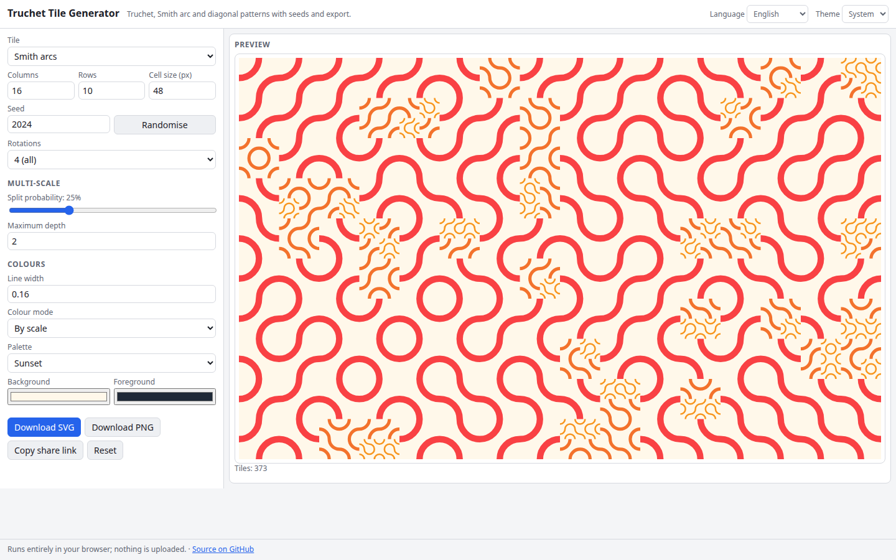

# Truchet Tile Generator

Generate Truchet tile patterns: Smith quarter-circle arcs, classic triangles, quarter discs and diagonals, optionally multi-scale, with reproducible seeds, palettes and SVG or PNG export.

**Try it: https://hermes98761234.github.io/truchet-tile-generator/**

[](https://github.com/hermes98761234/truchet-tile-generator/actions/workflows/deploy.yml)



## Features

- Four tile kinds: Smith arcs, classic triangles, quarter discs, diagonals (10 PRINT)
- 2-state (classic) or 4-rotation tilings from a seeded PRNG
- Multi-scale mode: cells recursively split into four with a probability and depth limit
- Colour by single colour, by scale level or random palette colour; adjustable line width
- SVG and PNG export; share link with all settings
- English and Ukrainian UI, light/dark/system theme, settings saved in the browser, shareable links
- Fully client-side: no backend, no tracking, your data never leaves the browser

## How it works

A mulberry32 PRNG seeded by the chosen seed picks a rotation for every cell (and whether to split it). Smith tiles join the midpoints of the cell sides with quarter circles of radius half the cell centred on opposite corners, so curves continue smoothly across cell borders.

## Quick start

```sh
npm install
npm run dev      # development server
npm test         # unit tests (vitest)
npm run lint     # oxlint
npm run build    # type-check and production build into dist/
```

## License

MIT, see [LICENSE](LICENSE).
